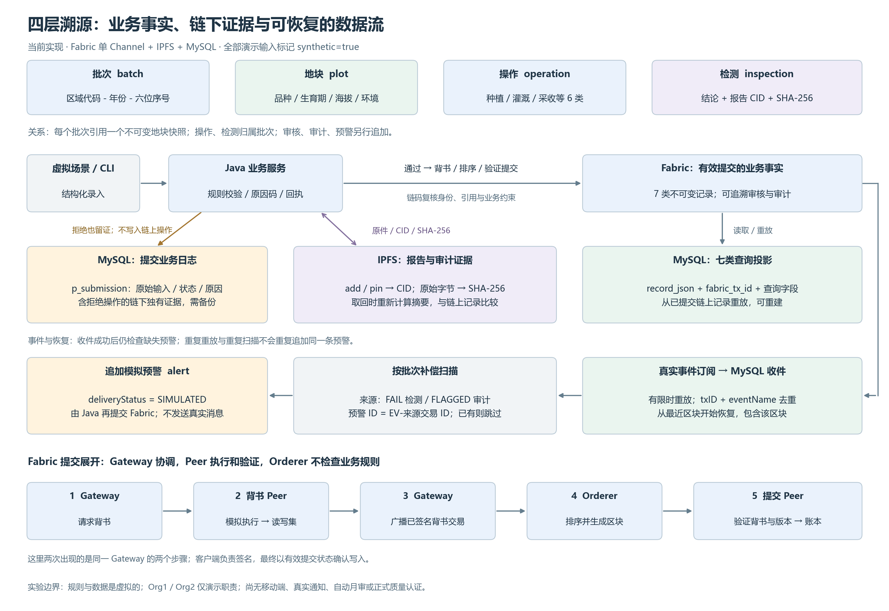

# Blockchain Storage Lab

这是一个以学习和后续研究为目标的溯源实验仓库。当前主业务是 **批次—地块—操作—检测**，使用 **Hyperledger Fabric + IPFS + MySQL**，先让每条记录的来源、去向和校验过程清楚可查。业务参考刘康辰《基于区块链的泰山茶可信溯源系统研究》的分域、链上链下分流、审核与事件设计；本版不做销售和防控算法。

## 先看四层数据

| 层 | 本版记录什么 | 放在哪里 |
|---|---|---|
| 批次 `batch` | 种植区代码、年份、序号、地块快照 ID、开始时间 | 全量上链，MySQL 保存查询投影 |
| 地块 `plot` | 作物、品种、生育期、海拔、环境描述 | 不可变快照全量上链，MySQL 保存查询投影 |
| 操作 `operation` | 种植、灌溉、采收、加工、仓储、观察的结构化记录 | 通过规则后全量上链；拒绝请求仅链下留证 |
| 检测 `inspection` | 检测结论、实验室、时间、报告 CID 与 SHA-256 | 关键字段上链，报告原件在 IPFS |

四层是业务关系，不是四条链。当前只有一个 Channel；每个批次引用一份确定的地块快照，操作和检测归属批次。另有 `review`、`audit`、`alert` 三类追加记录，分别保存专家审核、监管审计和预警处理事实。更正通过新增记录表达，不覆盖旧记录。

批次号形如 `DEMOTEA-2026-000001`，即“种植区代码－年份－六位序号”。`DEMOTEA` 为虚拟区域；场景数据均带 `synthetic: true` 和 `schemaVersion: 1`，链码目前也只接受此类实验记录。

## 当前架构与数据流



可缩放版：[SVG](docs/four-layer-architecture.svg)；关系与流程图源：[Mermaid](docs/four-layer-architecture.mmd)；重绘脚本：[render-architecture.py](scripts/render-architecture.py)。

1. Java 保存请求日志，用请求 ID 关联输入、状态和回执。操作调用链码只读预校验；明确不合规时返回原因码，原始请求保留在 MySQL。
2. 报告原件和审计输入快照通过 IPFS `add/pin` 保存。Java 另算原始字节的 SHA-256，将它与 CID 一并存证；CID 不是原文件 SHA-256 字符串。
3. Gateway 协调背书；Peer 模拟执行链码并返回读写集。客户端签名后，由 Gateway 广播给 Orderer；Orderer 排序形成区块，提交 Peer 验证背书与读版本，再应用有效写集。Orderer 不检查业务规则。
4. 得到有效提交确认后，Java 把请求标成 `COMMITTED`，并更新 MySQL 查询投影。报告查询从 Fabric 取可信锚点，再按 CID 取回字节并核验 SHA-256。
5. 场景程序通过真实 Fabric 事件接口有限时重放，MySQL 按 `txID + eventName` 去重。之后按批次补偿扫描，为 `FAIL` 检测和 `FLAGGED` 审计生成确定性 `EV-<来源交易 ID>` 预警；重复扫描跳过已有记录。

检测 `FAIL` 是应保留的事实，可以上链；它不能直接被审核为 `APPROVE`。预警状态固定为 `SIMULATED`，不发送真实短信、邮件或微信。哈希和账本支持完整性核验，不自动证明原始录入或检测结论真实。

## 数据库为什么分两部分

MySQL 的七类 `p_*` 业务投影保存链上记录的查询副本，**可以重放重建**。`p_submission` 保存原始请求、拒绝原因和提交状态，含有链下独有证据，**不能从 Fabric 完整恢复**。`p_event_inbox` 保存事件收件与去重进度，收件和投影更新在同一数据库事务中完成。

原始请求和摘要放在同一个数据库，并不抵抗管理员同时改动两者。当前审计把选定证据快照存入 IPFS，再把 CID 与摘要上链，形成后续核对点。MySQL 业务日志和 IPFS 对象仍需独立备份；单节点 pin 不等于多节点备份。Redis 保留为可选缓存，本版业务正确性不依赖 Redis，也没有宣称已实现缓存查询流程。

完整说明：[业务设计](docs/06-business-design.md)、[数据库设计](docs/07-database.md)、[数据流与故障边界](docs/05-data-flow.md)。

## 按这个顺序读代码

先读虚拟场景，再读规则与编排，最后进入网络和数据库细节。前五个类位于 `backend-java/src/main/java/lab/blockchain/backend/provenance/`。

| 顺序 | 文件 | 要弄懂的问题 |
|---|---|---|
| 1 | [SyntheticScenarioMain.java](backend-java/src/main/java/lab/blockchain/backend/provenance/SyntheticScenarioMain.java) | 一个批次怎样经历正常输入、拒绝、检测、审核、审计和预警？ |
| 2 | [ProvenanceRules.java](backend-java/src/main/java/lab/blockchain/backend/provenance/ProvenanceRules.java) | 如何识别实验输入、对象 ID 和规则原因码？ |
| 3 | [ProvenanceService.java](backend-java/src/main/java/lab/blockchain/backend/provenance/ProvenanceService.java) | 请求回执、报告上传、上链、查询与失败对账如何衔接？ |
| 4 | [FabricProvenanceLedger.java](backend-java/src/main/java/lab/blockchain/backend/provenance/FabricProvenanceLedger.java) | 怎么使用两个组织身份提交、查询和重放事件？ |
| 5 | [JdbcProvenanceStore.java](backend-java/src/main/java/lab/blockchain/backend/provenance/JdbcProvenanceStore.java) | 哪些 SQL 写入投影，哪些保留独立证据？ |
| 6 | [provenance_contract.go](chaincode-go/provenance_contract.go) | 绕过 Java 后，链码怎样继续约束身份、引用、时间、审核和不可变性？ |
| 7 | [002_provenance.sql](infrastructure/mysql/migrations/002_provenance.sql) | 实体、唯一键、外键和 JSON 原始记录如何对应？ |

代码目录职责：

```text
backend-java/               四层业务编排、Fabric Gateway、IPFS 与 JDBC 适配器
chaincode-go/               ProvenanceContract；旧 TraceContract 兼容保留
infrastructure/mysql/      初始化表与增量迁移
scripts/                   服务器环境、迁移、链码部署、场景运行与架构图重绘
data/synthetic/            虚拟输入与 PASS / FAIL 报告，不含真实农业认证数据
runs/synthetic/            本机或服务器生成的实验结果，不作为预先通过的证据
core-java/                 本地链、哈希、Merkle 等离线教学对照
docs/                      来源、业务、数据库、流程与教学图
```

旧 `TraceApplicationService` / `FabricIpfsDemoMain` 只展示文件 CID 上链闭环；`core-java` 不替代 Fabric，也不代表 SHT-PBFT。旧六阶段、销售和缓存设计保留为历史学习材料，不是当前主业务。

## 在实验室服务器运行

本地代码目录为 `D:/project/blockchain-storage-lab`；服务器使用独立的 `~/xc/blockchain-storage-lab`，与其他项目分开。Docker、Fabric、Kubo 与 MySQL 在服务器运行，本地只做代码与小范围测试。

以下命令以已有项目依赖容器、Fabric test-network 和 `mychannel` 为前提，在能够访问 Docker 的服务器 shell 中运行。`infrastructure/.env` 应已在服务器私下配置；`lab-env.sh` 加载数据库凭据与工具路径，不把密码放进 Git。Fabric 适配器从 `FABRIC_SAMPLES_DIR/test-network/organizations/` 读取 Org1、Org2 的 User1 身份；证书和私钥不提交仓库。

```bash
# 新环境首次部署；已有实验服务器直接使用下方的批次查询命令。
cd ~/xc/blockchain-storage-lab
source scripts/lab-env.sh
bash scripts/migrate-db.sh
bash scripts/fabric-network.sh deploy-provenance
bash scripts/run-synthetic.sh 1
```

`migrate-db.sh` 增量创建本版表，不删除旧数据。`deploy-provenance` 使用新的链码名 `provenance`，保留旧 `trace` 链码及其账本；默认用于版本 `1.0`、定义序号 `1` 的首次部署。后续升级应核对既有定义，再设置 `PROVENANCE_VERSION` 与 `PROVENANCE_SEQUENCE`，不要通过关闭网络或删除 Docker 卷重置历史。

场景 `1` 对应 `DEMOTEA-2026-000001`。新实验改用未用过的 `1..999999` 序号；程序拒绝覆盖已有 `summary.json`。输入在 `data/synthetic/scenario.json`、`report-pass.txt`、`report-fail.txt`。运行后检查 `runs/synthetic/<batchId>/summary.json`、`snapshot.json` 与 `audit-input.json`，以真实输出判断成功与否。

已有批次可通过独立查询入口继续学习，无需再次创建数据。以下命令默认只读比较 Fabric 与数据库投影，并按链上 CID / SHA-256 核验检测和审计原件；输出写入 `runs/query/`。只读查询与缺失投影恢复均已在服务器实测通过。

```bash
bash scripts/query-batch.sh DEMOTEA-2026-000003
# 仅在需要补齐缺失投影时使用；不覆盖冲突数据，不修改提交证据。
bash scripts/query-batch.sh DEMOTEA-2026-000003 --rebuild
```

对应代码是 [ProvenanceQueryMain.java](backend-java/src/main/java/lab/blockchain/backend/provenance/ProvenanceQueryMain.java)。默认展示筛选后的教学字段，比较时仍使用完整记录；它不提交新交易或上传文件。

服务器旧系统与新版工具的兼容处理采用项目工具目录和容器包装，不要求升级整个操作系统。环境版本与真实执行状态应按本轮服务器记录核验，不能由文档中的命令推断已经部署成功。

## 验证范围与下一步

2026-11-15 验证完成：本地和服务器 Java 共 13 个测试通过；服务器 Go 的 7 个顶层测试、10 个子用例通过。新 `provenance` 链码 `v1.0 / sequence 1` 已有效部署；第一轮批次 1 与 Git 版本复验批次 `DEMOTEA-2026-000003` 均返回 `PASS`。最终批次有 9 条链上业务记录，含 2 条模拟预警；独立查询、事件重放去重、补偿扫描幂等和指定投影缺失恢复均通过。代码版本、计数和原始产物见 [验证记录](docs/08-validation.md)。

批次 2 是中断后保留的部分实验，未标记成功；当前学习查询请用批次 3，新建实验从尚未占用的序号 4 开始。恢复测试只删除并恢复了本批次一个虚拟操作的 MySQL 投影，原始提交证据摘要前后完全一致。单元测试替身与真实服务器检查分别记录，不把功能验证解释为性能基准或生产验收。

本地运行：

```powershell
$env:JAVA_HOME='C:\Program Files\Eclipse Adoptium\jdk-17.0.21.9-hotspot'
& 'D:\develop\maven\apache-maven-3.10.0\bin\mvn.cmd' -q test
```

第一轮场景已检查：操作拒绝留证且不上链、重复批次与绕过 Java 提交被拒绝、检测 PASS/FAIL 上链、原件往返与篡改检测、审核权限、FAIL 不能 APPROVE、审计证据、事件去重、补偿预警幂等和投影重放。这些是功能与数据流检查，不是生产性能、抗攻击能力或论文实验复现。

本版是命令行实验；尚无移动端、全天候事件守护进程、真实通知、自动月审、正式质量认证、专家资质认证、因果归因或知识图谱写回。Org1MSP 演示生产/检测，Org2MSP 演示专家/监管，组织成员身份不等于具体人员具备资质。一个批次只关联一个地块快照，批次列表尚需后续分页扩展。

老师确定方案后，再决定多地块来源与拆合批、检测机构签名、细粒度授权、认证接口、持续订阅、多 Channel 或应用层 Radix-Merkle 实验。生产批次与共识提案批处理不是一个概念；当前未实现 SHT-PBFT、Fabric 底层 Radix 改造，也未复现论文性能数字。

## 来源与文档维护

第一篇泰山茶论文现已按用户提供的 PDF 核验，页码、文件 SHA-256 与取舍见 [来源文档](docs/03-provenance.md)。IPFS 是本项目的工程选择，不能归因于该论文。参考架构不等于复制作者源代码；论文原件、全文提取和截图不进入公开仓库。

每次改变代码或业务，同时更新本 README、对应模块 README、数据流与相关图源；新增功能要区分“已实现”“已测试”和“计划扩展”，避免让学习说明先于实际验证。
