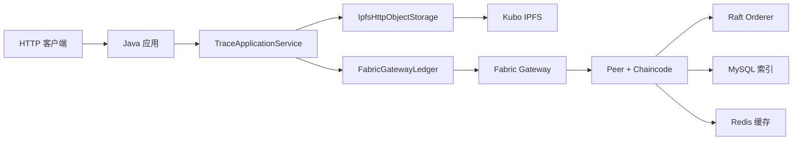

# 系统架构和责任边界

当前主链路直接使用 IPFS 和 Hyperledger Fabric：

## 写入顺序

1. Java 应用收到文件和溯源字段。
2. `IpfsHttpObjectStorage.add` 调用 Kubo `/api/v0/add`，得到 CID。
3. `IpfsHttpObjectStorage.pin` 调用 `/api/v0/pin/add`。
4. `TraceApplicationService` 生成 `TraceEvent`。
5. `FabricGatewayLedger.submit` 调用 `CreateTrace`。
6. Fabric 完成背书、排序、提交区块和 World State 更新。

## 查询顺序

1. 先查 Redis，未命中再查 MySQL 和 Fabric。
2. `QueryTrace(traceId)` 返回事件及 CID。
3. Java 调用 IPFS `/api/v0/cat`。
4. Java 重新计算文件摘要，校验取回内容。
5. 查询结果写回 MySQL/Redis。

## 模块职责

| 模块 | 职责 | 明确不做的事 |
|---|---|---|
| `TraceApplicationService` | 编排 IPFS 和 Fabric 的顺序 | 不处理 Fabric 网络细节 |
| `IpfsHttpObjectStorage` | `add/cat/pin` | 不决定业务阶段，不写 Fabric |
| `FabricGatewayLedger` | Gateway 连接、提交和查询交易 | 不上传文件，不访问 IPFS |
| `chaincode-go` | 保存 CID 和小型业务事实 | 不读取文件、MySQL、Redis 或 IPFS |
| MySQL | 页面字段、索引、同步状态 | 不替代 Fabric 可信事实 |
| Redis | 热点查询缓存 | 不作为最终数据源 |

## 可选离线模块

`core-java` 保留 `BlockchainLedger`、`MerkleTree` 和本地内容存储，用于学习哈希、区块和完整性校验。它是离线对照，不是当前系统的 Fabric 替代品。

## 失败场景

- IPFS 成功、Fabric 失败：保存待提交任务，重试 Fabric，之后清理孤儿 CID。
- Fabric 成功、MySQL 失败：以 Fabric 为准，补偿同步 MySQL。
- Redis 写入失败：返回已确认结果，下一次查询回源重建缓存。
- IPFS 内容校验失败：拒绝静默返回，标记对象异常。

## 后续扩展边界

老师确定具体方案后，再选择六阶段事件通知、多组织背书、多 Channel、私有数据集合、应用层 Radix-Merkle 或第一篇论文模块改造。所有扩展都保持“大文件在 IPFS、关键事实在 Fabric”的边界。
