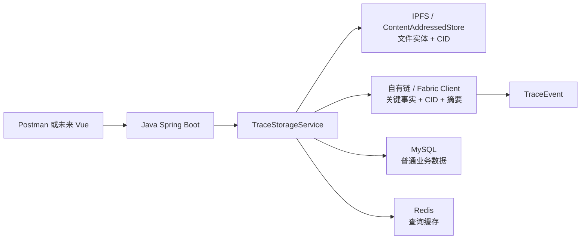

# 系统架构和替换边界

## 首版实现与论文路线的对应关系

| 论文/概念 | 首版实现 | 后续替换点 |
|---|---|---|
| IPFS 文件保存 | `ContentAddressedStore` | `IpfsClient`：`add/cat/pin` |
| Fabric 链上关键事实 | `BlockchainLedger` | `FabricClient`：`submitTrace/queryTrace` |
| 链码 `CreateTrace/QueryTrace/AppendEvent` | `TraceStorageService` + `TraceEvent` | `chaincode-go/contract/TraceContract.go` |
| 六个业务环节 | `Stage` 枚举 | 后续增加领域字段，不改变存储边界 |
| 第一篇按环节分组 | `StageBatcher` | 先做应用层批处理，再研究多 Channel/共识 |
| Radix-Merkle | 首版只保留标准 `MerkleTree` | 应用层前缀索引实验，不直接改 Fabric 底层 |

## 责任边界

- Controller 只接收请求和返回结果。
- Service 编排“文件先落链下、CID 再上链”的流程。
- 链码/账本只处理小型事实，不读取 MySQL、Redis 或文件本体。
- IPFS 适配器只负责 `add/cat/pin`，不决定业务阶段。
- Redis 只是可重建缓存，不能成为最终可信源。

## 失败场景

1. 链下上传成功、链上提交失败：记录 `upload_pending`，重试链上提交；最终清理孤儿对象需要单独任务。
2. 链上提交成功、Redis 写入失败：返回链上成功，下一次查询回源并重建缓存。
3. 文件节点离线：返回对象不可用，依靠 pin、多副本和健康检查恢复。
4. `traceId` 重复：链上接口应拒绝重复初始事件，追加事件使用独立事件序号。
