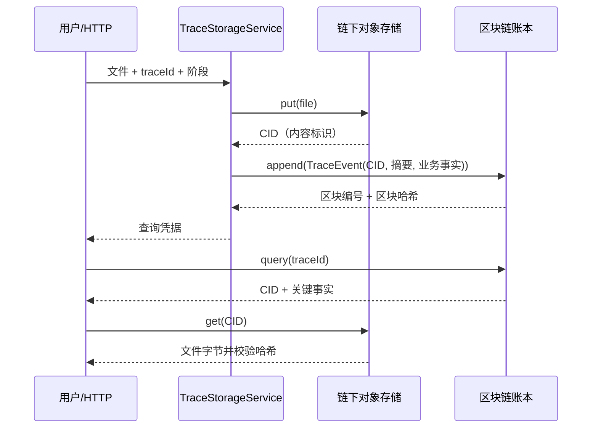

# 04：从一次文件上传看懂整个系统

这份讲义按“先看数据，再看代码，最后看 Fabric”来读。不要一开始背术语。只要能回答“这段数据现在在哪、谁负责改变它、怎样检查它”，就已经掌握了系统主线。

## 1. 先记住一条数据流



这条路线把“大文件”和“小事实”分开：文件实体不进入区块，区块只保存“文件在哪里、它是什么、谁在什么时候记录了它”。

## 2. 用一个例子逐步走代码

`DemoMain` 里有一张假的照片字节：`demo tea photo bytes`。

1. `ContentAddressedStore.put(bytes)` 调用 `Hashing.sha256Hex`。
2. 哈希被包装成教学版 `sha256:<64位十六进制>`，这就是本地适配器的 CID。
3. 文件写入 `offchain/objects/前两位/完整哈希`，同样内容再次上传不会重复保存。
4. `TraceStorageService` 创建 `TraceEvent`，其中有 `traceId`、`stage`、`contentCid`、`metadataHash` 等字段。
5. `BlockchainLedger.append(event)` 为事件创建一个区块。
6. 新区块保存 `previousHash`，所以修改前一个区块会破坏后续链条。
7. 查询时先按 `traceId` 找事件，再用 `contentCid` 取回文件。
8. `ContentAddressedStore.get` 会重新计算文件哈希；文件损坏时不会静默返回。

推荐阅读顺序：

```text
DemoMain
  -> TraceStorageService
     -> ObjectStore / ContentAddressedStore
     -> LedgerClient / BlockchainLedger
        -> TraceEvent
        -> Block
           -> MerkleTree
              -> Hashing
```

## 3. 哈希到底解决什么问题

哈希函数把任意长度输入映射成固定长度字符串。它不是加密，也不能从哈希反推出原文件。这里主要用它做两件事：

- **内容指纹**：文件字节改变，哈希通常改变；
- **链条连接**：区块把前一区块哈希放进 `previousHash`。

因此哈希能发现“保存后的内容或历史记录被改过”，但不能证明“最初录入的数据一定真实”。如果有人一开始就上传了假的照片，哈希只会忠实地指纹这份假照片。

## 4. Merkle 根为什么存在

一个区块可能包含多条事件。Merkle 树先给每条事件算哈希，再两两合并，最后得到一个根哈希：

```text
事件 A -> H(A) ----┐
                    -> H(H(A)+H(B)) --┐
事件 B -> H(B) ----┘                  |
                                       -> MerkleRoot
事件 C -> H(C) ----┐                  |
                    -> H(H(C)+H(D)) --┘
事件 D -> H(D) ----┘
```

本项目当前每个事件单独成块，所以 Merkle 根看起来很简单；保留 `MerkleTree` 是为了让以后做批量区块、Radix-Merkle 应用层实验时有清晰的替换位置。

## 5. CID、IPFS 和链下

本地 `sha256:<hash>` 只是教学标识。真实 IPFS 的 CID 由内容寻址协议生成，不应简单等同于普通 SHA-256 字符串。

“链下”不是“没有网络”，而是“数据不写入区块链账本”。

| 位置 | 保存对象 | 丢失后怎么办 |
|---|---|---|
| IPFS/对象存储 | 图片、视频、PDF、检测报告 | 依靠 pin、多副本和备份恢复 |
| 区块链 | CID、时间、操作者、事件阶段、摘要 | 不能随意改写；需要校验链条 |
| MySQL | 用户、页面字段、查询索引 | 从业务备份恢复 |
| Redis | 查询缓存 | 回源区块链/MySQL 重建 |

CID 只回答“如何找到这份内容、内容是否一致”，不回答“上传者有没有造假”。

## 6. 自有链和 Fabric 的对应关系

当前自有链是单进程、可验证的学习实现，不是多节点共识网络。它把几个 Fabric 角色先压缩在一起：

| 当前类 | 以后对应的 Fabric 概念 |
|---|---|
| `BlockchainLedger.append` | 提交交易后由排序服务生成区块并由 Peer 提交 |
| `BlockchainLedger.verify` | 节点校验区块链接和交易一致性 |
| `TraceEvent` | 链码维护的业务状态/历史事件 |
| `LedgerClient` | Java Fabric Gateway/SDK 适配器 |
| `ObjectStore` | IPFS 客户端适配器 |
| `Stage` | 业务字段，不是共识算法 |

Fabric 中：

- **Peer**：执行链码、背书、验证并保存账本；
- **Orderer**：接收交易、排序、打包区块；
- **Raft**：Orderer 集群使用的共识方式之一；
- **Channel**：隔离的账本空间；
- **Chaincode**：运行在 Peer 上的业务规则程序；
- **Gateway/SDK**：Java 后端调用 Fabric 的客户端入口。

所以 `LedgerClient` 的意义是：业务服务不直接依赖某个 Fabric SDK。以后从本地链换成 Fabric，主要替换适配器，而不是重写整个业务流程。

## 7. 为什么 MySQL 和 Redis 仍然需要

区块链不适合承载所有页面查询和大文件。MySQL 负责容易查询、可建立索引的普通业务数据；Redis 负责加速经常重复的查询。

一次查询可以是：

```text
Redis 命中 -> 直接返回缓存
Redis 未命中 -> 查区块链/MySQL -> 根据 CID 找文件 -> 写回 Redis
```

Redis 清空不应造成真实数据丢失。若系统只能从 Redis 找回记录，说明缓存和可信源的边界设计错了。

## 8. 你可以马上做的三个小实验

### 实验 A：改变文件

修改 `DemoMain` 中的 `photo` 内容，再运行一次。观察 CID 变化；这说明内容地址由文件内容决定。

### 实验 B：改变描述

只改变 `description`，文件不变。观察 CID 不变，但事件哈希和区块哈希变化；这说明文件指纹和业务事实是两个层次。

### 实验 C：模拟篡改

在测试里把事件换成另一个 `Stage`，重新计算出的区块哈希会不同。真实系统还需要把篡改后的区块放回链条，`verify()` 才能发现前后哈希不一致。

## 9. 首版边界和后续路线

当前已经能学习和验证：

- 文件与链上事实的分离；
- 内容寻址和完整性校验；
- 区块、前哈希、Merkle 根；
- Java 业务编排与可替换端口。

当前明确没有声称实现：

- Fabric 多组织网络和真正的 Peer/Orderer 集群；
- SHT-PBFT 或其他底层共识插件；
- 多 Channel 分账本和跨账本一致性；
- 生产级身份、权限、签名和灾备。

下一阶段应按这个顺序扩展：

1. 给本地链加持久化账本和世界状态索引；
2. 用真实 IPFS 替换 `ContentAddressedStore`；
3. 加 Spring Boot Controller、MySQL Repository、Redis Cache；
4. 在服务器部署 Fabric test-network 和 Go 链码；
5. 用 `LedgerClient` 接入 Fabric Gateway；
6. 再做第一篇论文的阶段分组、事件通知和应用层 Radix-Merkle 实验。
