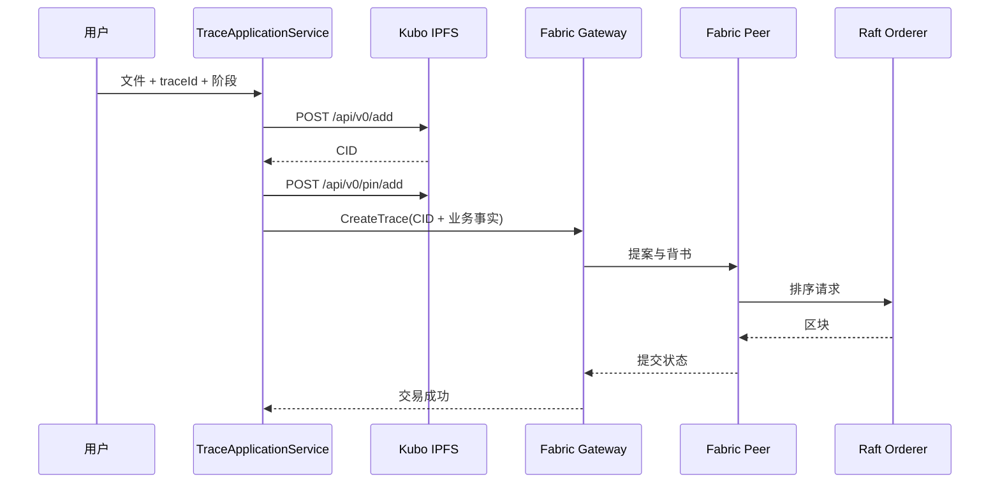

# 04：从一次文件上传看懂 IPFS + Fabric

阅读代码时不要先背术语。每一步都问：数据在哪里、谁负责改变它、怎样验证它。

## 1. 完整写入流程



核心顺序只有两步：先让 IPFS 保存文件，再让 Fabric 记录 CID。Fabric 链码不会读取 IPFS 文件。

## 2. 代码阅读顺序

```text
TraceApplicationService
  -> IpfsHttpObjectStorage.add / pin
  -> TraceEvent
  -> FabricGatewayLedger.submit
  -> chaincode-go.CreateTrace
```

查询时反向阅读：

```text
FabricGatewayLedger.query
  -> chaincode-go.QueryTrace
  -> TraceEvent.contentCid
  -> IpfsHttpObjectStorage.cat
  -> Java SHA-256 校验
```

## 3. Fabric 连接需要什么

`FabricGatewayConfig` 需要：

- Org1 的 MSP ID；
- Peer Gateway 地址，例如 `localhost:7051`；
- TLS CA 证书；
- 用户签名证书；
- 用户私钥；
- Channel 名称和链码名称。

这些证书只存在服务器运行目录。代码中只保留路径配置，不提交密钥。

## 4. 哈希和 CID 的关系

- IPFS CID 是 IPFS 的内容寻址标识；
- Java 可以额外保存 SHA-256，校验下载后的字节；
- Fabric 保存 CID 和元数据摘要；
- CID 和元数据摘要解决的是两类完整性问题，不能混为一个字段。

## 5. MySQL 和 Redis 的位置

```text
Fabric 确认成功
  -> MySQL 保存 traceId、阶段、CID 的查询索引
  -> Redis 缓存热点查询结果
```

MySQL 和 Redis 都属于查询层。它们丢失后，应该从 Fabric 事件和 IPFS 对象重新构建。

## 6. 当前可做的小实验

1. 只改变文件字节：IPFS CID 改变，Fabric 事件中的 CID 也改变。
2. 只改变描述：文件 CID 不变，Fabric 业务事件改变。
3. 删除 Redis：查询回源 Fabric/MySQL，再把结果写回缓存。
4. 让 IPFS `cat` 返回损坏内容：Java SHA-256 校验必须拒绝结果。

## 7. 老师确定方案后的扩展

先完成单 Channel、两组织、最小链码和真实 IPFS/Fabric 闭环，再讨论六阶段事件通知、多 Channel、私有数据集合、跨组织背书、应用层 Radix-Merkle 和第一篇论文模块修改。
