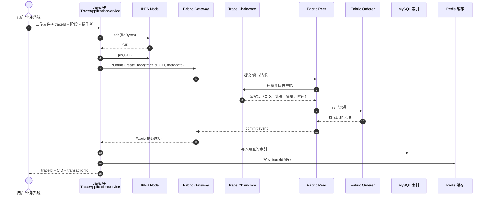
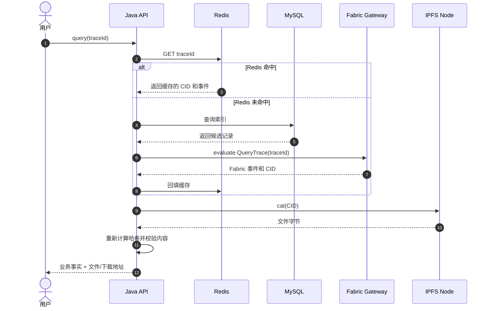
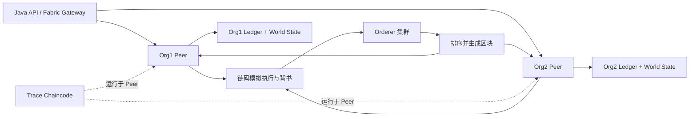
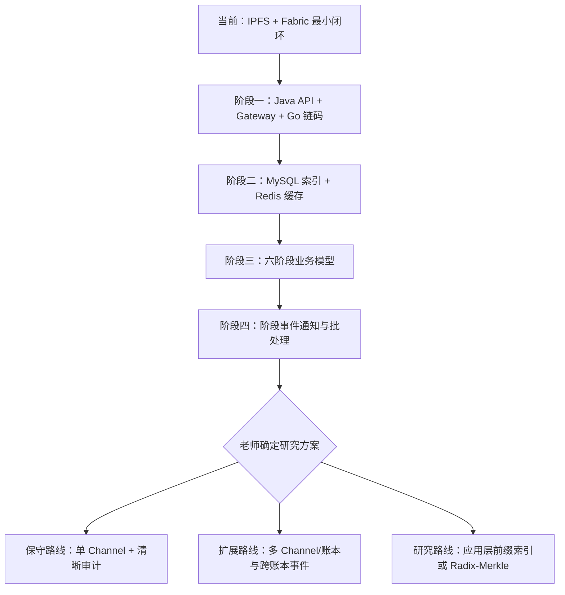

# 05：IPFS + Fabric 数据流与演进图

本文件描述本项目的主线架构：**文件使用 IPFS 保存，关键事实使用 Hyperledger Fabric 保存，MySQL 和 Redis 作为业务查询层**。本地教学链只保留为可选的结构对照，不作为主实现。

独立 SVG 图：[`architecture-data-flow.svg`](architecture-data-flow.svg)。服务器已完成一次真实闭环验证：`Fabric 2.5.16 + trace/1.0 + mychannel` 成功提交，Java 冒烟程序输出 `cid=...`、`fabricEvents=1`、`ipfsRoundTripVerified=true`。

## 1. 一次写入：文件先进入 IPFS，CID 再进入 Fabric



### 写入后各数据在哪里

| 数据 | 保存位置 | 作用 |
|---|---|---|
| 图片、检测报告、视频、PDF 字节 | IPFS | 大对象的实际内容 |
| CID | Fabric | 内容地址和完整性指针 |
| 阶段、操作者、时间、对象编号、元数据摘要 | Fabric | 需要共同见证的关键事实 |
| 页面查询字段和倒排索引 | MySQL | 方便分页、筛选和统计 |
| 常用 `traceId` 查询结果 | Redis | 加速访问，可删除后重建 |

CID 只指向文件内容；Fabric 记录“哪个对象在什么时间、由谁、处于哪个阶段关联了这个 CID”。两者结合后，文件和业务事实可以分别校验。

## 2. 一次查询：先走缓存，最终回到 Fabric 和 IPFS



Redis 丢失只会造成缓存未命中，不应造成链上事实丢失。MySQL 也属于查询层，可信事实以 Fabric 为准。

## 3. Fabric 内部发生了什么



当前第一阶段只需要一个可学习的 Fabric test-network、一个 Channel、两个组织和最小 Go 链码。后续再增加组织、身份、背书策略和真正的服务器部署。

- **Peer**：执行链码、进行背书、提交区块并维护账本。
- **Orderer**：对交易排序并生成区块。
- **Channel**：隔离账本和成员范围。
- **Chaincode**：只处理关键事实和状态，不读取 IPFS 文件本体。
- **Gateway**：Java 后端调用 Fabric 的入口。

## 4. 数据模型

链码中的最小事件可以保持如下结构：

```json
{
  "traceId": "TRACE-001",
  "objectId": "BATCH-001",
  "stage": "PROCESSING",
  "operatorId": "factory-01",
  "eventTime": "2026-11-12T10:00:00Z",
  "contentCid": "bafy...",
  "metadataHash": "sha256:...",
  "description": "processing record"
}
```

`contentCid` 是 IPFS 返回的 CID；`metadataHash` 用于检测链上业务字段是否被篡改；`traceId` 和 `objectId` 用于查询和关联六个阶段。

## 5. 项目推进路线



### 阶段一：可运行主线

目标是先完成：

1. 启动 Fabric test-network；
2. 部署 `TraceContract`；
3. Java 通过 Fabric Gateway 提交和查询事件；
4. Java 通过 IPFS API 完成 `add/cat/pin`；
5. 保存一条完整的 `文件 → CID → Fabric 交易 → 查询 → 文件校验` 记录。

### 阶段二：查询层

MySQL 和 Redis 只承担查询性能与页面需要：

```text
Fabric 确认成功
    -> MySQL 写索引
    -> Redis 写缓存
```

要设计补偿任务处理“IPFS 已成功但 Fabric 失败”“Fabric 成功但 Redis 写入失败”等情况。

### 阶段三：六个业务阶段

使用统一的 `traceId` 串联：

```text
PLANTING -> PICKING -> PROCESSING
         -> WAREHOUSE -> TRANSPORT -> SALES
```

每个阶段提交一条 Fabric 事件，文件仍然只进入 IPFS。这样可以先完成清晰的业务闭环，再决定是否需要多个 Channel。

### 阶段四：研究扩展

只有在老师确定方案后，才选择以下方向：

- 阶段事件通知和跨组织订阅；
- 按阶段拆分 Channel 或账本；
- 应用层批处理和前缀索引；
- 对第一篇论文的模块做可控改动；
- 单独设计共识、容错和性能实验。

这些扩展都基于同一条数据边界：**大文件在 IPFS，关键事实在 Fabric，普通查询在 MySQL，热点数据在 Redis**。

## 6. 故障与校验

| 故障 | 处理方式 |
|---|---|
| IPFS 上传成功，Fabric 提交失败 | 记录待提交任务，重试 Fabric；定期清理孤儿 CID |
| Fabric 提交成功，MySQL 失败 | 以 Fabric 交易为准，补偿写入 MySQL |
| Redis 写入失败 | 返回 Fabric 结果，下次查询回源并重建缓存 |
| IPFS 节点暂时不可用 | 返回 CID 和可重试状态，依靠 pin 和副本恢复 |
| 查询文件哈希不一致 | 拒绝静默返回，标记对象损坏并触发健康检查 |

## 7. 当前实现边界

本项目后续主实现直接面向 IPFS 和 Fabric。当前仓库中的本地 `BlockchainLedger` 仅用于理解区块、哈希和 Merkle 数据结构；它不替代 Fabric 网络，也不用于声称复现论文中的共识或实验结果。
