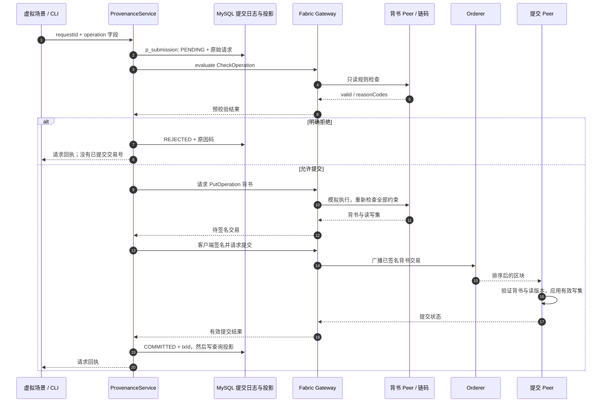
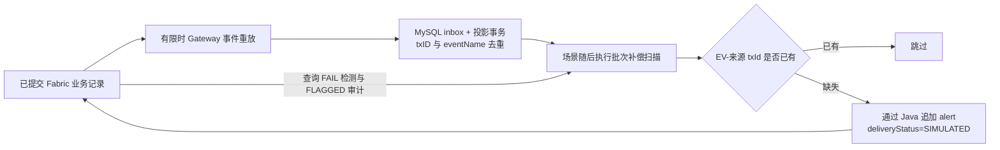

# 05：四层溯源数据流与故障边界

当前主入口为 `SyntheticScenarioMain`，以“批次—地块—操作—检测”组织业务，另追加审核、审计与预警记录。四层使用一个 Fabric Channel。本文描述代码中的调用与恢复设计；真实部署是否通过，应查看对应实验输出，不能把流程图当作运行证据。

架构图：[PNG](four-layer-architecture.png)、[SVG](four-layer-architecture.svg)、[Mermaid 图源](four-layer-architecture.mmd)。早期 `architecture-data-flow.svg` 和 `CreateTrace` 说明只保留为历史教学材料。完整对象定义见 [业务设计](06-business-design.md) 与 [数据库设计](07-database.md)。

## 1. 先区分三种结果

| 情况 | 业务含义 | 数据去向 |
|---|---|---|
| 操作规则校验通过 | 输入满足演示结构、引用和时间等约束 | 操作全量上链，MySQL 保存投影 |
| 操作规则明确拒绝 | 例如操作类型不支持、引用缺失 | `p_submission` 保存原始请求与原因码，不形成链上操作 |
| 检测结论为 `FAIL` | 检测结果不合格，而不是请求非法 | 检测事实与报告锚点仍上链，后续审核与审计可见 |

演示规则不是农业法规。对失败检测的专家审核可以追加 `REJECT`，不能直接追加 `APPROVE`。审核、审计和预警均是新记录，不改写原检测事实。

## 2. 一次操作写入：先留请求，再确认有效提交



`CheckOperation` 是只读预校验，不生成业务写入；`PutOperation` 会再次检查，防止调用者绕过 Java 直接提交无效输入。链码执行失败不能顺便留下一个有效合约事件，因此被拒绝请求的原文由链下日志保留。

客户端通过 Gateway SDK 完成签名与提交。Gateway 协调背书与广播，Peer 负责模拟执行和提交验证，Orderer 负责排序；不能把 Orderer 理解成审核农业规则的节点。

请求 ID 与 Fabric 交易 ID 不同。只有得到有效提交确认，回执才应标记 `COMMITTED`。超时或连接异常可能发生在提交前，也可能发生在提交已成功之后；当前服务使用 `UNKNOWN` 保留不确定性，而不是把它自动记为业务违规或成功。

## 3. 检测与审计附件：原件在 IPFS，锚点在 Fabric

```text
报告原始字节 ── SHA-256 ──────────────┐
报告原始字节 ── IPFS add / pin → CID ├→ inspection 链上记录
结论、实验室、检测时间、摘要 ──────────┘

所审记录 + 链下拒绝回执 → 审计输入快照 → IPFS add / pin
                                          ↓
                       CID + SHA-256 + 被审记录引用 + 结论 → audit 链上记录
```

CID 受 IPFS 内容编码和分块表达影响；`reportSha256` / `evidenceSha256` 则对原始字节计算。两者分别保存。链码只校验锚点格式、业务引用和提交身份，不会访问 IPFS，也不会自己读报告来判断结论。

报告查询由 `ProvenanceService.verifiedReport` 直接从 Fabric 读取检测记录，获得 CID 与 SHA-256，再执行 IPFS `cat` 并重新计算摘要。不一致时报 `REPORT_HASH_MISMATCH`，不能把被改动字节当成原报告返回。数据库查询副本不能替代这个链上锚点。

IPFS 上传与 Fabric 提交不是同一个事务。上传成功而上链失败，可能留下尚未被引用的对象；当前保留失败回执供对账，没有实现自动孤儿对象清理。Pin 只保证相应节点保留内容，不等于完整备份、长期可用性或敏感报告访问控制。

## 4. MySQL 投影与提交日志必须分开恢复

| 数据 | 作用 | 恢复方式与边界 |
|---|---|---|
| `p_plot` 到 `p_alert` | 七类已提交事实的查询投影 | 可按 Fabric `ListBatch` 返回的记录重放；相同内容幂等，冲突内容报错 |
| `p_submission` | 请求、输入摘要、状态、原因码与可选交易号 | 含链下独有证据，需独立备份，不能从链上完整重建 |
| `p_event_inbox` | 区块号、交易号、事件名、事件原文 | 保存收件去重与恢复进度；与事件对应的投影在同一事务提交 |

`ProvenanceService.rebuild(batchId)` 是查询投影的幂等补齐，不清空业务日志，也不静默覆盖冲突行。故障恢复时，应保留原库证据，在受控环境核对或重建投影；不要把“可以重放”解释成可随意删除整个数据库。

SQL 表同时保存查询字段与完整 `record_json`，后者包含真实交易 ID、提交者 MSP 与证书身份。业务字段 `operatorId` 是操作人声明，不能代替签名身份做权限判断。Redis 当前不参与上述流程。

## 5. 真实事件收件与模拟预警



当前订阅使用真实 Fabric 接口，场景每次调用设置 5 秒时限和最多 10000 个事件。结束一次调用不表示全链已经处理完，也不是常驻后台服务。恢复时从最近收件区块开始，包含该区块；同块重复事件按唯一键去重，避免因跳过整个区块漏掉后续事件。

`InspectionFailed` 与 `AuditFlagged` 分别对应失败检测和异常审计；普通提交使用 `RecordCommitted`。事件收件成功不代表通知已经完成。之后的批次扫描以链上来源为准，使用确定性 ID `EV-<来源交易 ID>` 补齐缺失预警，使程序在收件后退出时仍可由后续扫描恢复。

`SIMULATED` 仅表示实验处理痕迹。没有真实短信、邮件、微信推送，也没有真实人员确认。要接入真实通知，仍需发送队列、重试、供应商回执和幂等机制。当前程序检查重复重放与重复扫描，不能据此声称已经做过进程崩溃故障注入。

## 6. 故障时具体保留什么

| 故障或分支 | 当前处理 | 尚需注意 |
|---|---|---|
| 操作预校验明确拒绝 | 请求记为 `REJECTED`，保存原因码，不提交操作 | 演示原因码不代表真实农业法规 |
| IPFS / Fabric 调用异常 | 请求保留为 `UNKNOWN`，错误向调用方传播 | 先查链上记录对账，不盲目重发 |
| Fabric 已成功、回执丢失 | 重复请求先按对象查链，比较内容，再补齐回执和投影 | 内容冲突报错；查不到不能擅自宣称成功 |
| Fabric 已成功、投影失败 | 链上事实与成功回执保留，可重放补齐投影 | 多系统之间没有单一原子事务 |
| 事件重复送达 | inbox 比较唯一键与内容，相同事件不重复处理 | 事件收件进度不是外部消息送达回执 |
| 收件后、预警前退出 | 后续批次补偿扫描发现缺失预警并追加 | 当前没有自动常驻执行器 |
| 报告取回摘要不一致 | 拒绝静默返回，抛出摘要错误 | 哈希正确仍不能证明原始检测真实 |

## 7. 运行范围与后续扩展

运行步骤见 [项目 README](../README.md)，输入见 `data/synthetic/`。Git 版本完整场景 `DEMOTEA-2026-000003` 已返回 `PASS`，版本与产物见 [验证记录](08-validation.md)。早期 `trace` 的文件闭环验证不覆盖新七类记录、MySQL 和事件恢复。

独立查询命令为 `bash scripts/query-batch.sh DEMOTEA-2026-000003`，由 `ProvenanceQueryMain` 比较完整链上记录与数据库投影，并核验检测、审计证据的原始字节。已实测发现一个缺失的虚拟操作投影，再用 `--rebuild` 恢复到与链一致；提交证据前后保持不变。

当前一个批次绑定一个地块快照；查询列表有规模上限，尚无分页。Org1MSP 演示生产/检测，Org2MSP 演示专家/监管，没有细粒度人员授权或资质认证。

后续按老师方案扩展移动端、检测机构签名、认证适配器、持续事件订阅、定时审计与多地块关系。多 Channel、应用层 Radix-Merkle 与共识实验需要单独协议；本版没有实现销售、防控算法、因果归因、知识回写、SHT-PBFT 或 Fabric 底层 Radix 改造。
