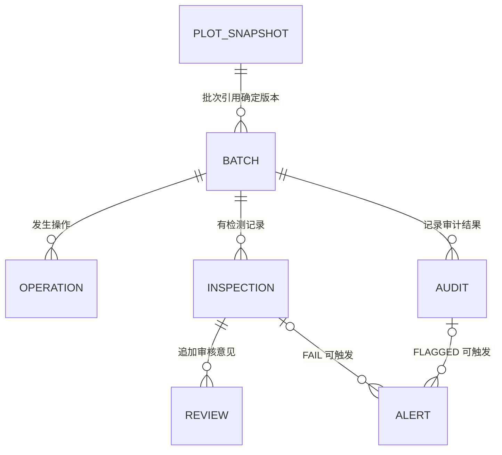
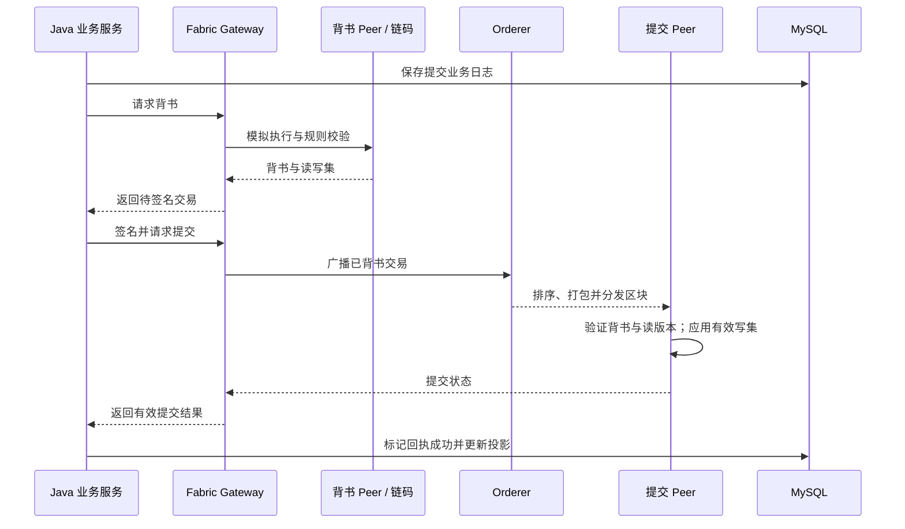

# 四层溯源业务与数据库：先理解一条记录如何流动

当前系统要回答的是：**某个生产批次来自哪块地，做过什么操作，检测结果是什么，谁审核过，证据能否重新取回并核验。** 业务参考泰山茶论文的分域管理、链上链下分流、事件通知与审核设计，论文证据见 [来源文档](03-provenance.md)。

本版本不做销售与防控推荐。操作类型先固定为 `PLANTING`、`IRRIGATION`、`HARVEST`、`PROCESSING`、`STORAGE`、`OBSERVATION`，分别表示种植、灌溉、采收、加工、仓储和观察记录。

架构图可查看 [PNG](four-layer-architecture.png) 或可缩放的 [SVG](four-layer-architecture.svg)。关系与数据流图源为 [Mermaid](four-layer-architecture.mmd)，排版脚本为 `scripts/render-architecture.py`；需要重绘时，在安装了 Matplotlib 且有可用中文字体的环境运行 `python scripts/render-architecture.py`。脚本手动排版，业务改变时需同步维护两份图源。

## 1. 四层不是四条区块链

四层表示业务对象之间的关系：



这是理解对象关系的示意图；数据库的实际外键与字段以 SQL 迁移为准。一条预警通过 `sourceKind + sourceId` 指向检测或审计中的一个来源，不要求同时关联两者。当前在一个 Channel 中区分 `plot`、`batch`、`operation`、`inspection`、`review`、`audit`、`alert` 七类不可变记录。我们不通过新增组织、Peer 或 Channel 来模拟每一种业务实体。完整表设计见 [数据库说明](07-database.md)。

一个批次当前绑定一个不可变地块快照。快照包含当时的品种、生育期、海拔、立地和环境描述；如果资料需要修正，建立新快照并明确新记录的引用，不悄悄覆盖历史。

批次编号采用：

```text
区域代码-年份-六位序号
例如：DEMOTEA-2026-000001
```

区域代码是编号命名空间，同一命名空间内的年份和序号不能重复。编号需要稳定；展示名称可放在独立字段。此演示的 `DEMOTEA` 是虚拟种植区，不是国家行政区划代码或正式认证代码。

## 2. 哪些数据放哪里

| 数据 | Fabric | MySQL | IPFS |
|---|---|---|---|
| 地块快照、生产批次 | 全量业务记录 | 已提交记录的查询投影 | 不需要 |
| 校验通过的操作 | 全量业务记录 | 投影与提交回执 | 不需要 |
| 校验拒绝的操作 | 不写入合格操作集合 | `p_submission` 保存原始输入、原因码与提交状态 | 当前不需要 |
| 检测记录 | 结论、关键字段、报告 CID、报告 SHA-256 | 查询投影、流程状态 | 报告原件 |
| 审核与预警处理 | 追加业务记录 | 查询投影与事件处理进度 | 当前不需要 |
| 审计 | 结果、被审记录引用、证据 CID 与 SHA-256 | 查询投影 | 本次审计输入快照 |

这里有两种不同的 MySQL 数据：

- **投影**：把已提交链上记录组织成容易查询的行，可从 Fabric 重放构建。
- **业务日志**：记录用户提交过什么、为什么被拒绝、是否正在提交、哪个事件已经处理。尤其是未上链原始证据，不能只靠 Fabric 恢复。

因此 MySQL 在本项目中既有可重建的查询层，也保存需要独立备份的链下业务证据。Redis 仍是可选缓存，不参与本版本正确性的判定。

七类投影表分别为 `p_plot`、`p_batch`、`p_operation`、`p_inspection`、`p_review`、`p_audit`、`p_alert`。每张表保存便于筛选的字段，并保留完整 `record_json` 与 `fabric_tx_id`。`p_submission` 是提交日志，`p_event_inbox` 是事件收件与处理进度。提交日志不对批次设置外键，因为“引用了不存在的批次”本身也是需要留下的无效输入证据。

## 3. 先沿着一个虚拟批次走一遍

以 `DEMOTEA-2026-000001` 为例，所有样例内容均为虚拟数据，并携带 `synthetic: true` 与 `schemaVersion: 1`。输入位于 `data/synthetic/scenario.json`，两份报告原件为同目录下的 `report-pass.txt` 与 `report-fail.txt`。命令行入口 `SyntheticScenarioMain` 接受一个整数 `sequence` 参数，默认是 `1`，并将其写成六位批次序号；新实验使用新序号，避免覆盖已经生成的实验结果。

1. 创建 `plot` 快照，记录虚拟地块的品种、海拔与环境。
2. 创建 `batch`，引用刚才的快照 ID。链码检查引用是否存在、编号是否重复。
3. 录入 `IRRIGATION` 操作。业务层校验结构，链码再次校验关键约束，提交成功后保存回执并更新查询投影。
4. 再提交一条故意不符合演示规则的操作，观察原因码；它在 MySQL 留下原始提交证据，不进入合格操作集合。
5. 分别上传虚拟 `PASS` 与 `FAIL` 检测报告。IPFS 返回 CID；Java 计算原始字节 SHA-256，并把两条关键检测事实提交到 Fabric。
6. 专家组织追加审核意见。原检测记录保持原样；不合格检测不能被标成通过审核。
7. 监管组织将本批次审计输入快照存入 IPFS，并追加 `FLAGGED` 审计结果。程序有限时重放真实 Fabric 事件并写入收件表，再通过补偿扫描分别为 `FAIL` 检测与 `FLAGGED` 审计生成模拟预警。
8. 查询批次全景，按检测记录中的 CID 取回原件，再计算 SHA-256。哈希一致才表示取回的字节与存证时相同。

真实执行结果、提交 ID 和测试输出由场景程序生成，写入 `runs/synthetic/<batchId>/`，其中 `summary.json` 是检查结果，`snapshot.json` 是批次查询快照。文档中的示例编号不是实际执行回执。

## 4. 校验失败、检测失败和专家审核是三件事

**操作校验失败**表示输入未通过当前版本的规则。例如操作类型不支持、引用缺失或字段不合法。业务层应返回原因码，并保存请求证据。演示规则不等于农业法规。

**检测结论 `FAIL`**是一条应被记录的检测事实。它可以上链，供后续审计查看。不能因为结果不合格就丢弃报告。

**专家审核**是独立的后续动作。审核意见追加成新记录，包含所审核对象的标识；它不会改写原始检测。当前规则不允许将 `FAIL` 检测直接 `APPROVE`。如果检测需要更正，应建立新检测和新证据，再重新审核。

当前身份只用组织范围演示职责：Org1MSP 负责生产与检测，Org2MSP 负责专家与监管。生产录入人、检测机构、专家资格、审核授权仍需在正式系统中进一步区分，不能把“属于 Org2MSP”解释为已获得专家认证。

## 5. Fabric 写入成功的准确含义



Gateway 协调背书与提交，Peer 执行和验证业务交易，Orderer 负责排序与生成区块。Orderer 不代替链码检查业务规则。

链码返回错误时，不会得到已成功提交的业务写入或有效合约事件。因此链下拒绝证据不能依赖“让报错交易顺便发出事件”；它由 Java 业务日志单独保存。

应用请求回执 ID 用于追踪一次提交。Fabric 交易 ID 用于查链上交易。只有得到有效提交确认，才应把业务记录描述为“已上链”。网络超时可能意味着结果尚不确定，不能将其简单等同于业务违规；应按请求标识与链上记录查询结果对账。

## 6. 为什么同时保存 CID 和 SHA-256

CID 是 IPFS 的内容地址，受内容编码、分块和 DAG 表达影响。`reportSha256` 是对报告原始字节计算的摘要。二者用途不同，不应把 CID 字符串当作原文件 SHA-256。

写入顺序为：

```text
报告字节 → SHA-256
报告字节 → IPFS add / pin → CID
检测关键字段 + SHA-256 + CID → Fabric
```

取回顺序为：

```text
Fabric 检测记录 → CID → IPFS cat → 报告字节
报告字节 → 重新计算 SHA-256 → 与链上摘要比较
```

IPFS 写入与 Fabric 提交不是一个分布式事务。文件成功上传但链交易失败时，文件可能暂时成为未被业务记录引用的对象；重试与清理由业务层管理。Pin 表示节点保留对象，不等于已经具备多节点备份。

## 7. 事件、审计和通知如何衔接

论文的跨账本事件思想，在当前单 Channel 版本中先落实为“链上业务事件 → 链下收件与补偿检查 → 链上处理痕迹”。`FabricProvenanceLedger.replay` 使用真实 Fabric Gateway 事件订阅接口，从指定区块重放；场景程序每次调用设置 5 秒时限与最多 10000 个事件。时限到达会结束本次读取，因此它不是全天候订阅服务，也不表示一次调用必然已经读取全链所有事件。

`p_event_inbox` 以 `交易 ID + 事件名` 去重，收件与投影更新在同一个数据库事务中完成。从最近已收件区块开始恢复时，包含该区块，避免漏掉同一区块后面的事件；重复事件由唯一键和内容检查识别。这里持久化的是收件进度，不能把“已收到事件”解释成“已完成外部通知”。

随后，场景程序扫描该批次已提交记录，为 `conclusion=FAIL` 的检测和 `conclusion=FLAGGED` 的审计生成预警。每条预警的 ID 固定为 `EV-<来源记录的 Fabric 交易 ID>`，并保存 `sourceKind` 与 `sourceId`。已有该 ID 时跳过，因此重复扫描不会重复追加同一预警。这个补偿步骤使“事件已收件、程序却在写预警前退出”的情况可以在后续扫描中补齐；恢复机制不依赖事件恰好只送达一次。当前脚本检查了事件重复重放和补偿重复扫描的幂等性，没有据此声称已完成进程崩溃故障注入测试。

预警的 `deliveryStatus=SIMULATED`。没有向真实用户、专家或监管人员发送短信、邮件或消息；预警日志只记录模拟处理事实，不代表真实人员已收到或确认。若后续接入真实消息渠道，还需设计发送队列、重试、供应商回执与发送幂等，不能直接把目前的模拟状态改名为“已送达”。

审计结果、专家意见与预警处理记录均采用追加方式。后续如果引入定期审计、外部通知和多人协作，仍需保留对象标识、规则版本、执行身份、时间和证据引用。

## 8. 建议的读代码顺序

先读对象和业务分支，再读网络调用。当前代码放在 `backend-java/src/main/java/lab/blockchain/backend/provenance/`，可按以下顺序阅读：

1. `SyntheticScenarioMain.java`：从一个完整虚拟场景理解输入、调用和验证输出。
2. `ProvenanceRules.java`：看实验标记、入口 ID 与批次编号；具体操作规则以 Go 链码为准。
3. `ProvenanceService.java`：看一次业务调用如何协调数据库、链与报告存储。
4. `FabricProvenanceLedger.java`：看业务记录如何转为 Fabric 提交与查询。
5. `JdbcProvenanceStore.java` 与数据库迁移：区分查询投影、提交日志和事件进度。
6. Go 链码的四层业务实现：核对身份、引用关系、不可变记录与合约事件。

原来的 `TraceApplicationService` 与 `FabricIpfsDemoMain` 是早期 CID 上链闭环示例，仍可用于入门；新业务以四层模型为准。

## 9. 这一步验证什么，下一步再做什么

当前目标是通过虚拟数据检查引用关系、输入校验、链上链下分流、报告取回校验、审核追加、事件去重、补偿扫描与数据库重放。它是功能与数据流测试，不是生产安全认证、真实农业效果评价或论文性能复现。

后续可以按老师的决定逐项扩展：多地块批次与拆合批、细粒度用户角色、正式检测机构签名、质量认证系统接口、持续事件订阅和定时审计、多 Channel 隔离、可控的应用层 Radix-Merkle 实验。

当前入口是命令行实验，尚未实现移动端、质量认证适配器、全天候事件守护进程、自动月度调度、专家资质认证、因果归因、知识图谱写回、模型更新、SHT-PBFT 和 Fabric 底层 Radix 改造。
