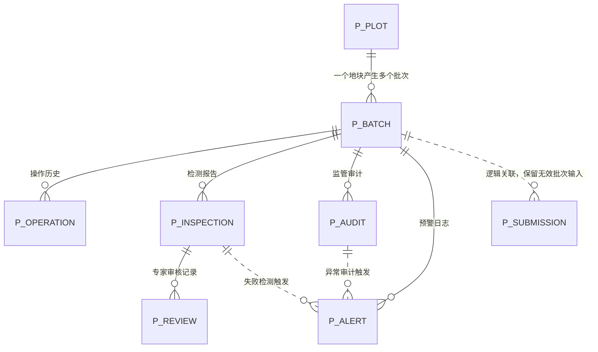
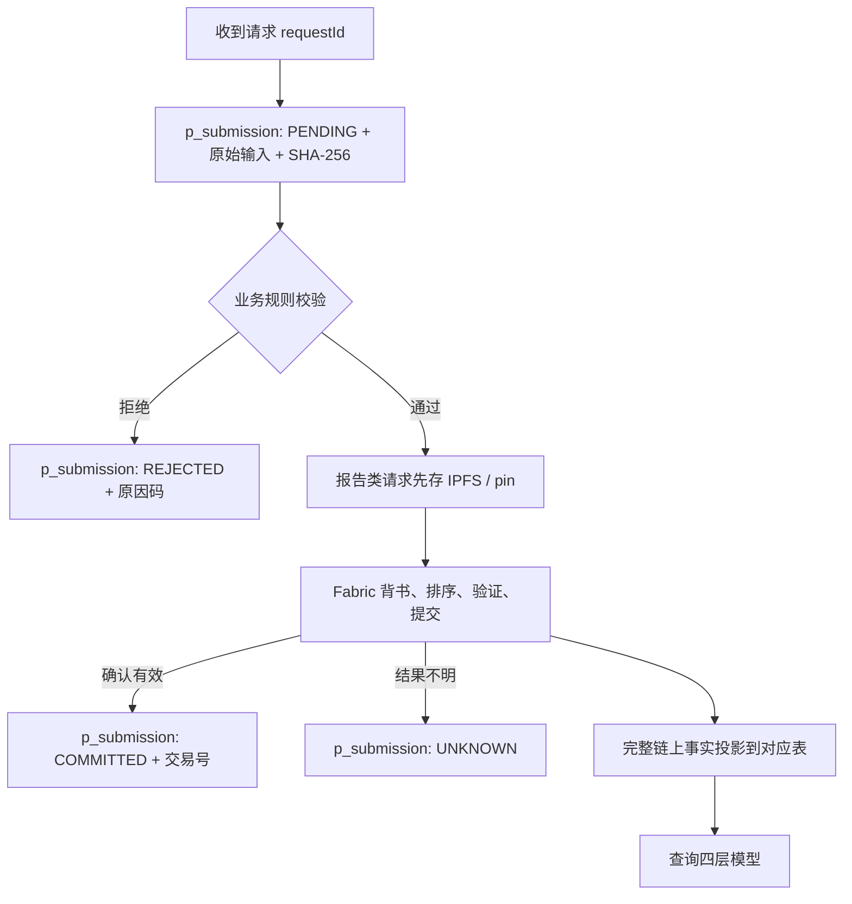

# 数据库：从业务对象到表，再到链上事实

本版用“批次—地块—操作—检测”组织溯源数据。它们是业务实体层，不是四个数据库或四个 Fabric Channel。一个批次当前对应一个地块，一个地块可以产生多个批次；每个批次可以包含多次操作和多次检测。销售与防控算法不进入本版业务。

## 先分清两种数据库数据

`p_plot` 到 `p_alert` 保存 Fabric 已提交记录的查询副本，称为**投影**。完整链上记录在 `record_json` 中，常用字段同时放进普通列，便于查询和关联。投影可以按链上事实重建。

`p_submission` 保存业务收到的原始请求，包括被拒绝操作的输入、摘要和原因码。失败的请求不会成为 Fabric 的有效业务状态，因此该表是独立的链下证据，必须备份。仅把 SHA-256 与原文放在同一个数据库，并不能抵抗管理员同时修改两者；审计时把选定证据快照放到 IPFS，再把快照 CID 与摘要存入审计记录，才形成外部核对点。

`p_event_inbox` 记录已经处理的合约事件，是订阅者的去重和恢复进度。它与投影在同一个 MySQL 事务内提交。

## 实体关系



图中虚线关联不全部实现为 SQL 外键。例如，原始请求可能引用不存在的批次，这正是需要保存的拒绝原因，不能让外键阻止其落库。预警来源是 `inspection` 或 `audit` 两种对象之一，链码验证来源存在、批次相同、结论确实需要预警。

| 表 | 主键 / 关键字段 | 数据来源与作用 |
|---|---|---|
| `p_plot` | `plot_id`；`region_code`、作物、品种、生育期、海拔、环境 | 地块全量上链后的查询副本 |
| `p_batch` | `batch_id`；区域、年份、序号、`plot_id`、开始时间 | 批次全量上链；区域+年份+序号另有联合唯一约束 |
| `p_operation` | `operation_id`；`batch_id`、`plot_id`、类型、时间、操作者声明、说明、规则版本 | 通过规则的完整操作；同一批次允许多条相同类型操作 |
| `p_inspection` | `inspection_id`；`batch_id`、报告 CID、原件 SHA-256、结论、实验室、时间、摘要 | 关键字段上链；报告原件存 IPFS |
| `p_review` | `review_id`；`batch_id`、`inspection_id`、决定、意见 | 专家确认记录；真实提交者身份保留在完整链上记录中 |
| `p_audit` | `audit_id`；`batch_id`、被审计记录列表、证据 CID/摘要、结论、意见 | 固定一次审计的范围、证据与结果 |
| `p_alert` | `alert_id`；`batch_id`、来源、接收对象、模拟投递状态 | 记录预警演示；`SIMULATED` 不代表真实短信或通知送达 |
| `p_submission` | `request_id`；原始输入、输入摘要、状态、原因码、可选交易号 | 提交回执和链下失败证据；不是缓存 |
| `p_event_inbox` | `(fabric_tx_id, event_name)`；区块号、事件原文 | 订阅去重与恢复进度；不是业务实体表 |

七个投影表都包含 `record_json` 和 `fabric_tx_id`。JSON 中的 `submitterMsp` 与 `submitterId` 由合约从签名身份提取；操作里的 `operatorId` 是业务声明值，不能用来决定谁有专家或监管权限。

批次号例子：`DEMO01-2026-000001`。其中 `DEMO01` 是演示种植区代码，`2026` 是年份，`000001` 是该区域该年的序号。Fabric 对键执行唯一性检查，SQL 的 `(region_code, production_year, sequence_no)` 约束负责防止查询副本出现另一种重复表示。数据库 ID 使用大小写敏感排序规则，以保持与 Fabric 键语义一致。

## 一次写入为什么分几步



IPFS、Fabric 和 MySQL 之间没有一个覆盖全部系统的原子事务。不能把“请求发出”写成“上链成功”，也不能把网络断开判定为业务违规。

| 状态 | 含义 | 后续动作 |
|---|---|---|
| `PENDING` | 输入已保存，调用尚未确认结束 | 正常执行或恢复检查 |
| `COMMITTED` | Fabric 已确认有效提交，有交易号 | 投影失败时可从链上补投影 |
| `REJECTED` | 当前业务服务由操作 `CheckOperation` 明确拒绝时写入 | 保留原文和原因；修正后使用新的请求号 |
| `UNKNOWN` | 超时、连接异常等导致结果不明确 | 先查询链上记录/提交状态，再决定是否重试 |

当前教学实现只把操作预校验 `CheckOperation` 返回的明确无效结果记为 `REJECTED`。其余上传或提交异常统一保守记录为 `UNKNOWN`，其中也可能包含合约拒绝；尚未实现按 Fabric 异常类型细分拒绝码，不能把所有提交异常描述为违规。

同一个 `requestId` 只能关联完全相同的原始输入。`begin` 新插入返回 `true`，遇到相同的既有请求返回 `false`，不会重置状态；换输入必须换请求号。业务服务据此区分首次执行与恢复：既有 `PENDING` 或 `UNKNOWN` 请求先读取链上同编号记录并比较内容，匹配时补记 `COMMITTED` 和原交易号并恢复投影，查无记录或内容不符时继续保留 `UNKNOWN`，不能盲目重发。这样即使“链上成功、数据库回执更新失败”，也不会在重试时因链上已有记录而把成功请求误写成拒绝。

`COMMITTED` 与 `REJECTED` 是终态，禁止直接改写成另一状态。若真实业务需要纠错，应追加一条关联旧记录的更正事实，而不是覆盖历史。

## 事件消费与重建

`JdbcProvenanceStore.acceptEvent` 的单次数据库事务依次执行：

1. 查询 `(txId, eventName)` 是否已处理；
2. 写入或核对对应业务投影；
3. 保存事件与区块号；
4. 一次提交。失败则全部回滚。

同一事件再次到达时返回 `false`，不会重复增加投影。同一记录编号如果对应不同 JSON 或不同交易，则报 `PROJECTION_CONFLICT`，禁止悄悄覆盖。

当前假设只有一个按 Fabric 顺序消费的订阅者。`lastBlock()` 返回已处理的最大区块号；恢复时**从该区块开始包含式重放**，不能直接跳到下一块，因为一个区块可能还有未消费事件。没有事件时返回 `0`。未来如果接入多个通道、多个链码或并行消费者，需要把通道和链码加入消费进度及去重键。

全量重建投影时按 `plot → batch → operation/inspection → review/audit → alert` 处理，保持外键依赖顺序。保留 `p_submission` 及原始证据备份。演示测试若需要删除投影，只允许限定于该次合成数据的准确编号；不能对实验室共用数据库清空整表。

## 部署与读取代码

迁移文件是 [`infrastructure/mysql/migrations/002_provenance.sql`](../infrastructure/mysql/migrations/002_provenance.sql)。它只新增表，不删除或改写旧 `trace_record`，可以重复执行。已有 MySQL 数据卷不会再次执行首次初始化目录，因此需要显式运行迁移。

在服务器项目目录执行以下命令，数据库名和密码仍从已忽略的 `.env` 取得，不写入 Git：

```bash
set -a
. infrastructure/.env
set +a
docker exec -i -e MYSQL_PWD="$MYSQL_PASSWORD" bsl-mysql \
  mysql --default-character-set=utf8mb4 -u"$MYSQL_USER" "$MYSQL_DATABASE" \
  < infrastructure/mysql/migrations/002_provenance.sql
```

应用通过 `MYSQL_URL`、`MYSQL_USER`、`MYSQL_PASSWORD` 接收连接参数。`JdbcProvenanceStore` 构造函数接收 URL、账号、密码，不会自动迁移。

学习顺序：先看本页表格，再读 `ProvenanceStore` 的接口，最后读 `JdbcProvenanceStore.projectInsideTransaction`。该方法按实体逐个列出 SQL，没有 ORM 隐式映射，每个字段都能对应回上表。演示中时间用 ISO-8601 字符串存储；后续做大范围时间检索时，应统一时间精度与 UTC 规范并迁移为可索引时间列。

## 查询已有批次

服务已启动且 Java 已按部署步骤编译后，在项目根目录运行：

```bash
bash scripts/query-batch.sh --help
bash scripts/query-batch.sh DEMOTEA-2026-000001
bash scripts/query-batch.sh DEMOTEA-2026-000001 --rebuild
```

请把例子替换为已运行实验的真实批次号。默认命令只读取 Fabric、MySQL 和 IPFS，不发交易、不上传文件、不改数据库。`--rebuild` 按链上的依赖顺序补齐该批次及其关联地块的七类投影，完整内容相同时跳过；发现同编号不同内容则报错，禁止静默覆盖。它不删除行，不改 `p_submission`、事件收据或其他批次。地块可能被多个批次共用，因此不会删除后重建地块。

输出包含每类链上/数据库记录数量、数据库脱敏快照、完整投影一致性判断，以及每份检测报告和审计证据的 IPFS 原件 SHA-256 核对结果。核对使用链上的 CID 和摘要，不能用数据库副本自证。`MATCH` 表示原件与链上摘要相符；`HASH_MISMATCH` 表示内容不符；`UNAVAILABLE` 表示本次未能取回，不能据此断定被篡改。哈希一致只证明与锚定字节一致，不证明报告结论真实或签发机构资质。

查询摘要另存于 `runs/query/<批次号>-<UTC时间>-<随机后缀>/summary.json`，不覆盖原实验。展示及保存都不包含密码、证书身份、操作者声明、接收对象、原始请求和自由评论；一致性比较仍在内存中使用完整 envelope。若投影或文件核对失败，摘要保留且命令返回非零。脚本只调用 Maven `exec:java`，不重复构建全项目；新增或更新代码后仍需先执行部署构建。
